# Tip Court

[](https://github.com/tech-anupam/VibeFinance)
[](https://nextjs.org/)
[](https://www.typescriptlang.org/)
[](https://tailwindcss.com/)
[](https://groq.com/)
[](https://turso.tech/)
[](https://tavily.com/)
[](https://vitest.dev/)

> Autonomous multi-agent financial intelligence platform turning market feeds, regulatory filings, and social chatter into evidence-backed, personalized verdicts for retail investors.

**Builder:** Anupam Jha | **Repository:** [tech-anupam/VibeFinance](https://github.com/tech-anupam/VibeFinance) | **Hackathon:** Wild Bugs 2026

---

## Problem

Retail investors are targeted with unsolicited stock tips across Telegram, WhatsApp, and social media:
- "Guaranteed 50% breakout in 2 weeks!"
- "Promoter accumulation secretly underway!"
- "Zero debt hidden multibagger, buy now!"

Hedge funds use Bloomberg terminals and dedicated research teams to verify claims. Retail investors lack the tools to parse 200-page regulatory filings, distinguish real growth from pump-and-dump operations, or evaluate portfolio risk before risking capital.

---

## Solution

Tip Court runs every stock tip or ticker query through a simulated adversarial trial before capital is committed:
- **5 parallel AI agents** cross-examine the stock across filings, live market metrics, and web sentiment.
- **Deterministic TypeScript analytics** calculate RSI, MACD, Volume Z-Score, and portfolio concentration (HHI). The LLM never computes math.
- **Deterministic arbiter** produces a final verdict with an exact trade execution plan.
- **Anti-hallucination verifier** drops uncited claims and replaces them with an "insufficient evidence" label.

| Verdict | Meaning | Recommended Action |
|---|---|---|
| **PROCEED** | Strong fundamentals, verified filings, positive momentum. | Safe to enter with recommended position sizing. |
| **REDUCE_SIZE** | Solid business, but high valuation or portfolio concentration. | Halve your allocation to protect downside. |
| **WAIT_48H** | High volatility or imminent event risk (earnings, policy). | Allow price action to settle for 2 days. |
| **AVOID** | False claims, high debt, red flags, or severe overbought signals. | Stay away and preserve your capital. |

---

## Interface

### Stock & Tip Input
Supports direct stock evaluation and social media tip verification. Features an intuitive currency switcher (INR, USD, EUR, GBP) and quick allocation presets.

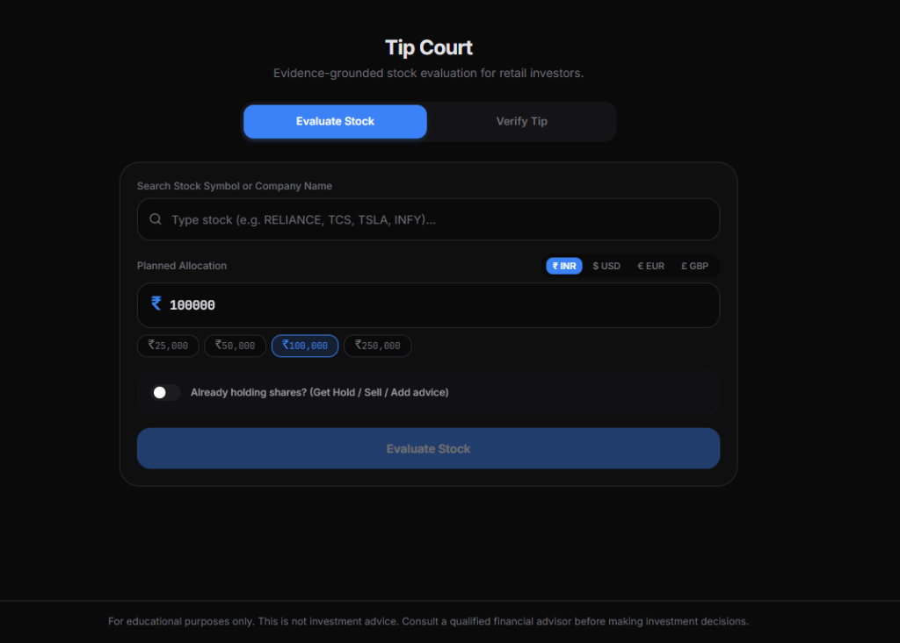

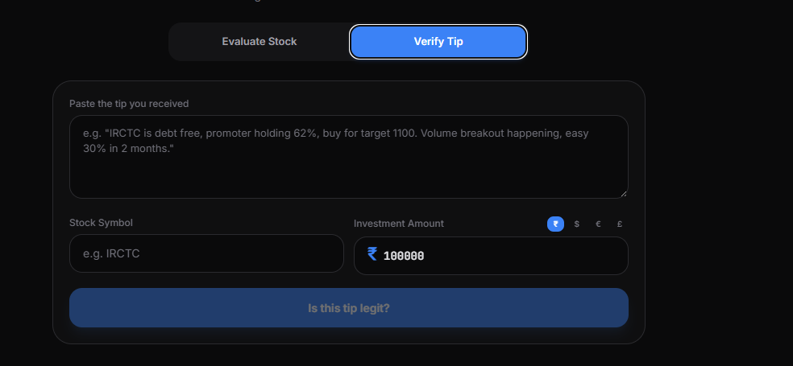

### Price Feed Autocomplete
Live autocomplete search across NSE, BSE, NASDAQ, and NYSE equities with real-time price quotes, daily percentage changes, and 1-month SVG sparklines.

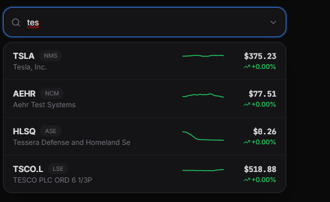

### Existing Holdings Advice
Toggle to enter currently owned shares and average purchase price to receive personalized `HOLD`, `BOOK PROFITS`, `ACCUMULATE`, or `CUT LOSS` recommendations.

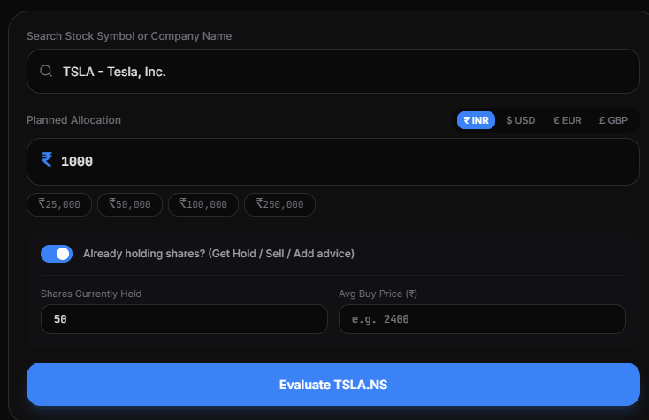

### Courtroom Trial
Parallel specialized agents present opposing evidence. The Prosecutor argues the technical risk case, while the Defence highlights fundamental balance sheet resilience.

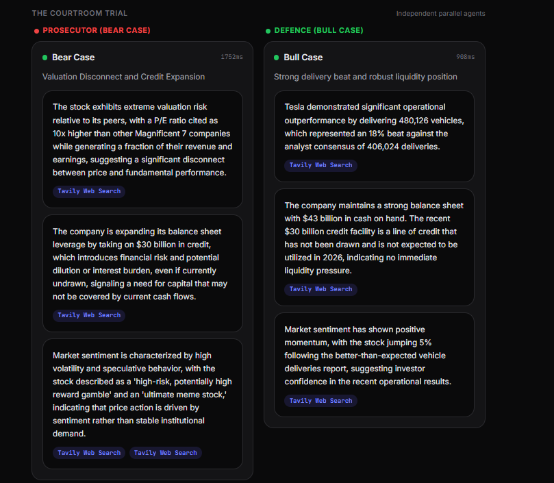

### Conflict Resolution
Surfaces a Split Court alert whenever agents report high opposing confidence, displaying categorized bear, bull, and audit findings with verified citations.

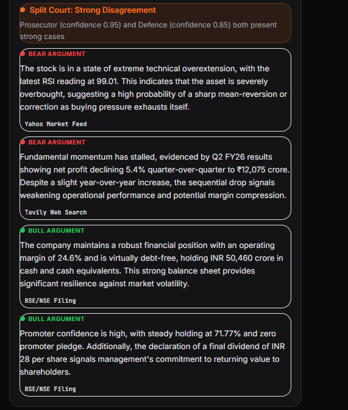

### Evidence Stream
Every finding carries a verified citation link to audited BSE/NSE filings, Yahoo Finance live data, or Tavily web sentiment.

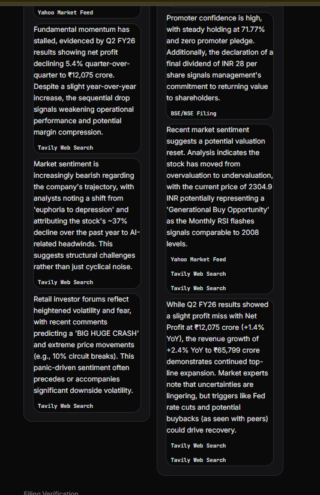

### Risk Meter
Displays a 0 to 100 Regret Risk Score gauge, individual agent confidence levels, and a multi-axis risk shape radar chart.

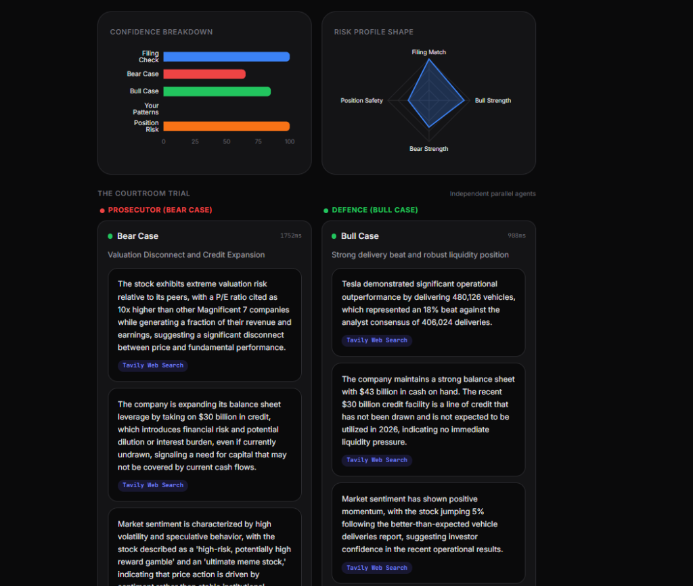

### Report Export Toolbar
One-click export toolbar to download official trial reports as formatted Print/PDF documents, Excel CSV spreadsheets, or Markdown documentation.

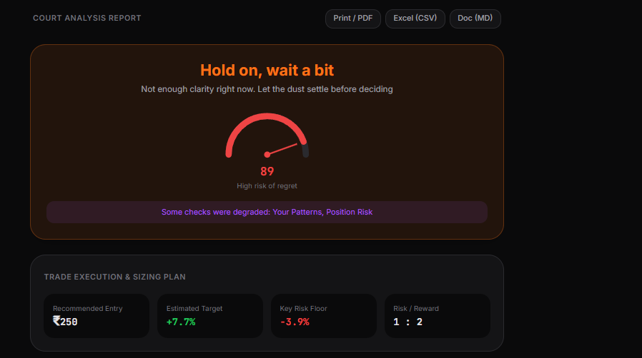

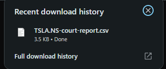

### Community Sentiment & Metrics
Aggregates real-time investor sentiment from Reddit, Stocktwits, and financial forums via Tavily, paired with a sub-5s runtime execution metrics strip.

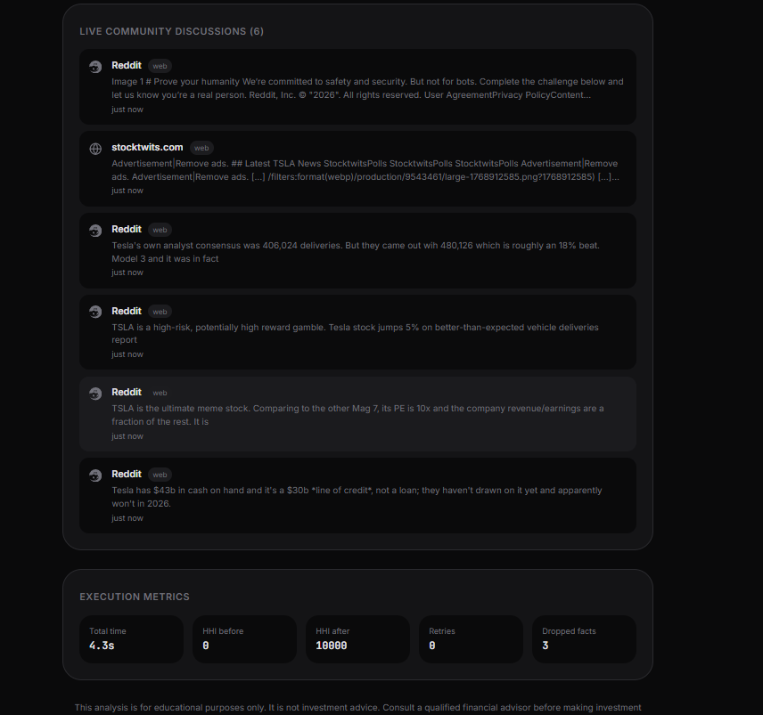

---

## Pipeline

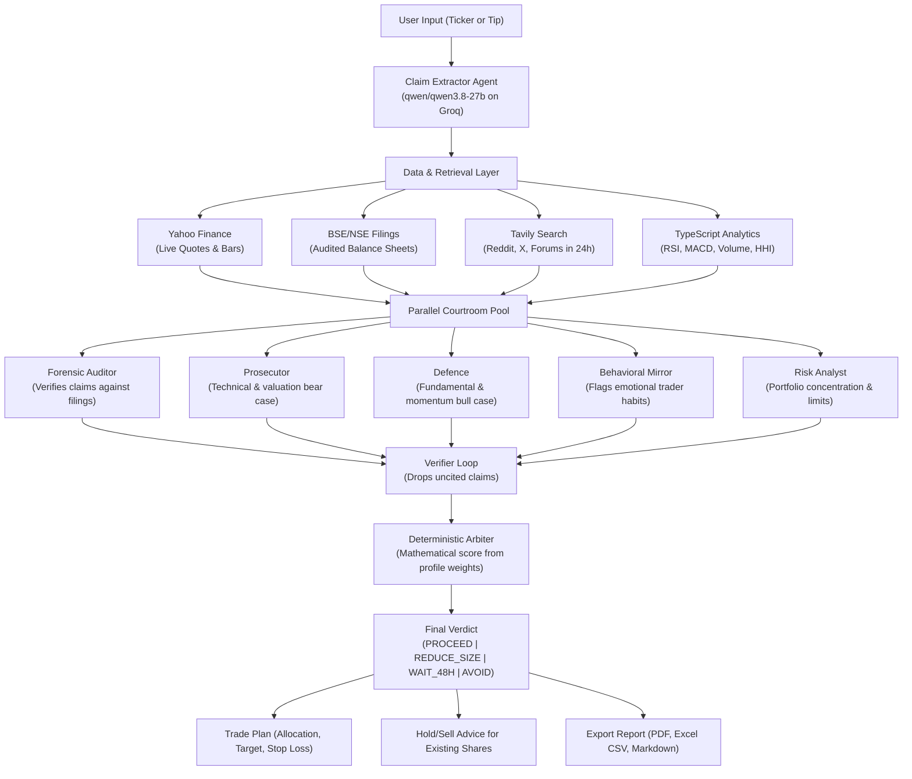

---

## Core Features

- **Global Equities Autocomplete:** Live quotes and SVG sparklines across NSE, BSE, NASDAQ, and NYSE.
- **Multi-Currency Support:** Native INR (default), USD, EUR, and GBP support.
- **Actionable Trade Plan:** Suggested allocation, profit target price, stop-loss floor, and risk-to-reward ratio.
- **Existing Shareholder Guidance:** Personalized advice (`HOLD`, `BOOK PROFITS`, `ACCUMULATE`, `CUT LOSS`) based on user cost basis.
- **One-Click Export:** Download reports formatted for Print/PDF, Excel CSV, or Markdown documentation.

---

## Database Design

Tip Court uses Turso (libSQL) with Drizzle ORM to maintain an audit trail and personalize decisions:

1. **`profiles`:** Stores investor archetypes (Conservative, Aggressive, Panic-Seller) with individual risk thresholds and agent weights.
2. **`trades`:** Stores execution history to detect behavioral patterns (averaging down, panic selling, FOMO entries).
3. **`sessions`:** Full audit log of extracted claims, agent findings, citations, and arbiter scores.
4. **`filing_chunks`:** Pre-chunked annual reports and disclosures for sub-second BM25 retrieval.

---

## Documentation

| Guide | Badge | Topic |
|---|---|---|
| [System Architecture](https://github.com/tech-anupam/VibeFinance/blob/main/docs/ARCHITECTURE.md) | [](https://github.com/tech-anupam/VibeFinance/blob/main/docs/ARCHITECTURE.md) | Pipeline sequence, arbiter weighting formula, agent contracts, degraded modes. |
| [RAG & BM25](https://github.com/tech-anupam/VibeFinance/blob/main/docs/RAG.md) | [](https://github.com/tech-anupam/VibeFinance/blob/main/docs/RAG.md) | Annual report chunking, Okapi BM25 ranking, anti-hallucination citation verification. |
| [Agent Extender & Skills](https://github.com/tech-anupam/VibeFinance/blob/main/docs/SKILLS.md) | [](https://github.com/tech-anupam/VibeFinance/blob/main/docs/SKILLS.md) | GitHub skills loader, provenance checks via `SOURCE.md`, tool sandbox, BM25 selector. |
| [Data Provenance](https://github.com/tech-anupam/VibeFinance/blob/main/docs/DATA.md) | [](https://github.com/tech-anupam/VibeFinance/blob/main/docs/DATA.md) | BSE/NSE filings, Yahoo Finance, Tavily recency filter, local cache fallback. |

---

## Tech Stack

| Layer | Technology | Purpose |
|---|---|---|
| **Frontend** |  | React 19 App Router and Server Components |
| **Language** |  | Strict typing with zero `any` |
| **Styling** |  | Mobile-first dark theme UI |
| **Inference** |  | Fast JSON inference (`qwen/qwen3.8-27b`) |
| **Database** |  | Edge SQLite database managed via Drizzle ORM |
| **Web Research** |  | Real-time social discourse from Reddit, X, and forums |
| **Market Feeds** |  | Live quotes and historical daily price bars |
| **Testing** |  | 31 automated tests across math, indicators, skills, and RAG |

---

## Quickstart

### 1. Clone & Install
```bash
git clone https://github.com/tech-anupam/VibeFinance.git
cd VibeFinance
pnpm install
```

### 2. Configure Environment (`.env`)
```env
GROQ_API_KEY=your_groq_api_key
TURSO_DATABASE_URL=your_turso_db_url
TURSO_AUTH_TOKEN=your_turso_auth_token
TAVILY_API_KEY=your_tavily_api_key
```

### 3. Initialize Database
```bash
pnpm run seed
```

### 4. Start Development Server
```bash
pnpm run dev
```
Open [http://localhost:3000](http://localhost:3000) in your browser.

---

## Testing

- `pnpm test` : Runs all 31 unit tests (technical indicators, HHI concentration, behavioral bias detector, BM25 retrieval, skills loader, trade planning).
- `pnpm run eval` : Runs 20 real-world benchmark scenarios and outputs verdict agreement rate, claim precision, and latency percentiles.
- `pnpm run build` : Compiles production Next.js build.

---

## License

MIT License. Developed for the Wild Bugs 2026 Hackathon by **Anupam Jha**.  
Repository: [github.com/tech-anupam/VibeFinance](https://github.com/tech-anupam/VibeFinance)
