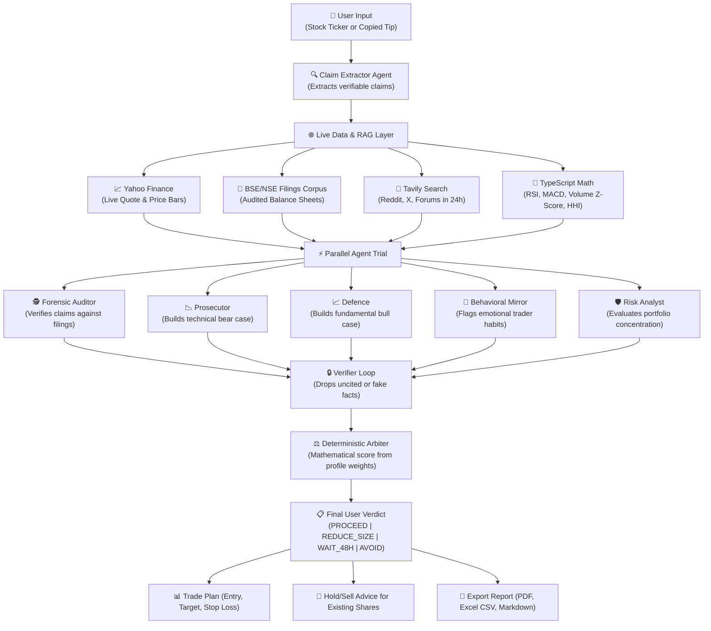

# VibeFinance: Tip Court

[](https://github.com/tech-anupam/VibeFinance)
[](https://nextjs.org/)
[](https://www.typescriptlang.org/)
[](https://tailwindcss.com/)
[](https://groq.com/)
[](https://turso.tech/)
[](https://tavily.com/)
[](https://vitest.dev/)

> Multi-agent autonomous financial intelligence platform turning raw market data, regulatory filings, and social chatter into evidence-backed, personalized verdicts for retail investors.

**Builder:** Anupam Jha | **Repository:** [tech-anupam/VibeFinance](https://github.com/tech-anupam/VibeFinance) | **Hackathon:** Wild Bugs 2026

---

## The Real Problem: Noise, Tips, and Retail Losses

Retail investors are flooded with unsolicited stock tips on Telegram groups, WhatsApp channels, and YouTube videos:
- *"Guaranteed 50% breakout in 2 weeks!"*
- *"Promoter accumulation secretly underway!"*
- *"Zero debt hidden multibagger, buy now!"*

Institutional hedge funds have Bloomberg terminals, data pipelines, and research teams to verify claims. Retail investors do not have the time to read 200-page annual filings or know whether a tip is a real opportunity or an orchestrated pump-and-dump trap.

---

## What Tip Court Delivers

**Tip Court** puts every stock query or social tip through a simulated trial before capital is put on the line.

Instead of relying on a single conversational chatbot, Tip Court executes **5 specialized AI agents in parallel**. They cross-examine the stock across audited filings, live market metrics, and real-time community discussions, delivering one clear verdict:

| Verdict | What It Means to You | Action |
|---|---|---|
| **PROCEED** | Strong fundamentals, verified filings, positive momentum. | Safe to enter with recommended position sizing. |
| **REDUCE_SIZE** | Solid business, but high valuation or portfolio concentration. | Halve your allocation to protect downside. |
| **WAIT_48H** | High volatility or imminent event risk (earnings, policy). | Allow price action to settle for 2 days. |
| **AVOID** | False claims, high debt, red flags, or severe overbought signals. | Stay away and preserve your capital. |

Every finding carries an exact clickable citation link (BSE/NSE filing, Yahoo live feed, or Tavily web search). Unverified claims are tagged as **insufficient evidence**.

---

## User Interface & Live Screenshots

### 1. Stock & Tip Input with Currency Switcher
Enter a direct stock query or paste raw social media tips from WhatsApp or Telegram. Select your currency (INR, USD, EUR, GBP), set planned allocation, or toggle existing shareholdings for hold/sell guidance.


### 2. SVG Live Price Feed & Autocomplete Stock Select Menu
Search any stock across NSE, BSE, NASDAQ, or NYSE. View real-time quotes, percentage movements, and 1-month SVG sparklines directly inside the dropdown.


### 3. The Courtroom Trial: Prosecutor vs Defence
Parallel specialized agents present opposing evidence. The Prosecutor argues the technical risk and valuation headwind case, while the Defence highlights fundamental balance sheet resilience and market momentum.


### 4. Audited Evidence Stream & Source Citations
Every argument is backed by a verified, clickable citation link to audited BSE/NSE filings, Yahoo Finance market feeds, or real-time Tavily web discussions. Unsubstantiated claims are dropped.


### 5. Evidence Analysis & Conflict Resolution
When agents disagree, Tip Court surfaces a **Split Court** alert card and lists verified arguments categorized by Bear Argument, Bull Argument, and Filing Audit.


### 6. Regret Risk Gauge, Confidence Bars & Radar Chart
Visual verdict summary featuring a 0 to 100 Regret Risk Score gauge, individual agent confidence meters, and a multi-axis risk shape radar chart.


---

## How It Works: Interactive Flowchart



---

## Practical Features for Traders

- **Clean Stock Search:** Auto-complete search across all NSE, BSE, NASDAQ, and NYSE equities with real-time quotes and 1-month sparkline charts.
- **Smart Currency Support:** Native support for Indian Rupee (INR) by default, plus USD, EUR, and GBP with clean, compact amount inputs.
- **Trade Execution Plan:**
  - Suggested starting amount based on volatility.
  - Estimated profit target price and percentage.
  - Recommended stop-loss floor level.
  - Realistic Risk-to-Reward ratio (e.g. 1 : 2.4).
- **Hold or Sell Advice for Existing Shareholders:**
  - Toggle to input shares currently owned and average purchase price.
  - Receives tailored advice: `HOLD`, `BOOK PROFITS`, `ACCUMULATE`, or `CUT LOSS`.
- **Direct Report Exporting:**
  - **Print / PDF:** Clean, print-formatted executive summary.
  - **Excel (CSV):** Tabular data file containing verdict, scores, all agent findings, and source links.
  - **Doc (Markdown):** Complete markdown report ready for sharing.

---

## Why Database Is Used (In Plain English)

The PS04 Hackathon problem statement requires personalized investor profiling and persistent historical tracking:

1. **User Risk Profiles (`profiles` table):**
   Stores distinct investor archetypes (Conservative, Aggressive, Panic-Seller) with individual concentration thresholds (HHI limits) and agent weights.
2. **Behavioral History (`trades` table):**
   Persists past trade executions. The Behavioral Mirror agent scans this history to detect emotional flaws (averaging down on losers, panic selling on dips, FOMO buying).
3. **Audit Trail (`sessions` table):**
   Every trial run stores extracted claims, agent findings, citations, verifier retries, and the final score for regulatory compliance.
4. **Pre-Indexed Filings (`filing_chunks` table):**
   Stores pre-chunked annual reports and corporate announcement excerpts for sub-second retrieval augmented generation (RAG).

---

## Detailed Documentation

- [System Architecture & Agent Contracts](docs/ARCHITECTURE.md) : Detailed pipeline flow, arbiter weights, and verifier loop.
- [Retrieval-Augmented Generation (RAG) & BM25](docs/RAG.md) : Document chunking, Okapi BM25 ranking, and anti-hallucination citation verification.
- [Agent Extender & Modular Skills (GitHub Integration)](docs/SKILLS.md) : Dynamic BM25 skill selector, provenance enforcement via `SOURCE.md`, and zero-trust sandboxing.
- [Data Provenance & Source Disclosures](docs/DATA.md) : Data adapters, caching policies, and degraded mode behavior.

---

## Technology Stack

| Layer | Technology | Purpose |
|---|---|---|
| **Frontend Framework** |  | React 19 App Router and Server Components |
| **Language** |  | Strict typing with zero `any` |
| **Styling** |  | Responsive mobile-first dark UI |
| **AI Inference** |  | Ultra-fast JSON inference (`qwen/qwen3.8-27b`) |
| **Database** |  | Edge SQLite database managed via Drizzle ORM |
| **Live Research** |  | Real-time social discourse from Reddit, X, and forums |
| **Market Feeds** |  | Live quotes and historical daily price bars |
| **Unit Testing** |  | 31 automated tests across math, indicators, skills, and RAG |

---

## Quickstart

### 1. Clone & Install
```bash
git clone https://github.com/tech-anupam/VibeFinance.git
cd VibeFinance
pnpm install
```

### 2. Configure Environment (`.env`)
```env
GROQ_API_KEY=your_groq_api_key
TURSO_DATABASE_URL=your_turso_db_url
TURSO_AUTH_TOKEN=your_turso_auth_token
TAVILY_API_KEY=your_tavily_api_key
```

### 3. Initialize Database
```bash
pnpm run seed
```

### 4. Start Development Server
```bash
pnpm run dev
```
Open [http://localhost:3000](http://localhost:3000) in your browser.

---

## Verification & Testing

- `pnpm test` : Runs all 31 unit tests (technical indicators, HHI concentration, behavioral bias detector, BM25 retrieval, skills loader, trade planning).
- `pnpm run eval` : Runs 20 real-world benchmark scenarios and outputs verdict agreement rate, claim precision, and latency percentiles.
- `pnpm run build` : Compiles production Next.js build.

---

## License

MIT License. Developed for the Wild Bugs 2026 Hackathon by **Anupam Jha**.  
Repository: [github.com/tech-anupam/VibeFinance](https://github.com/tech-anupam/VibeFinance)
