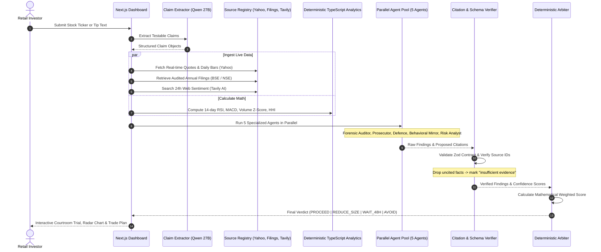

# System Architecture: Tip Court

## 1. High-Level Pipeline Flow



---

## 2. Agent Output Contracts

Every agent strictly implements the `AgentResult` schema defined in `src/schemas/agent.ts`. No agent can output arbitrary freeform text:

```ts
export interface Finding {
  text: string;
  sourceIds: string[];
}

export interface AgentResult {
  agent: string;
  status: "ok" | "degraded" | "failed";
  label: string;
  confidence: number; // 0.0 to 1.0
  findings: Finding[];
  latencyMs: number;
  error?: string;
}
```

---

## 3. Mathematical Arbiter Formula

The final decision is computed deterministically in TypeScript (`src/core/arbiter.ts`). The LLM never decides the verdict:

$$\text{Final Score} = \frac{\sum_{i=1}^{N} w_i \cdot c_i \cdot s_i}{\sum_{i=1}^{N} w_i}$$

Where:
- $w_i$ is the weight of agent $i$ configured in the user's risk profile.
- $c_i$ is the agent's verified confidence (0.0 to 1.0).
- $s_i$ is the agent's signal (+1 for Bull/Defence, -1 for Bear/Prosecutor, 0 for neutral).

### Profile Weightings

| Agent | Conservative Profile | Aggressive Profile |
|---|---|---|
| **Forensic Auditor** | 0.90 | 0.50 |
| **Prosecutor (Bear)** | 0.90 | 0.40 |
| **Defence (Bull)** | 0.20 | 0.80 |
| **Behavioral Mirror** | 0.60 | 0.30 |
| **Portfolio Risk (HHI)** | 0.80 | 0.30 |

---

## 4. Anti-Hallucination Verifier Loop

1. **Schema Check:** Validates structure via Zod.
2. **Provenance Audit:** Verifies that every `sourceId` in an agent's findings exists in the session `SourceStore`.
3. **Drop Rule:** Any finding citing an invented or missing source is immediately stripped and replaced with `"Insufficient evidence: [reason]"`.
4. **Retry Budget:** Agents failing validation are given one re-prompt with the exact error. If failure persists, the agent is marked `degraded` and confidence is capped at 0.4.

---

## 5. Graceful Degradation Handling

- **Price Feed Down:** Technical and momentum agents return `status: degraded`. Max confidence is capped at 0.4, a degraded banner is displayed, and the pipeline safely completes.
- **Missing Filings:** Forensic Auditor marks claims as `unverifiable`. The Arbiter is mathematically locked from returning `PROCEED`.
- **Disagreement & Split Court:** When Prosecutor and Defence both report confidence $>0.80$, the UI flags a `Split Court` alert and sets the verdict to `WAIT_48H` or `REDUCE_SIZE`.

---

## 6. Agent Extender & Modular Skills System

Courtroom agents can be extended with modular domain skills imported from public GitHub repositories or custom community packages.

- Read the complete [Agent Extender & Skills Guide](SKILLS.md) for details on `SKILL.md` frontmatter, `SOURCE.md` provenance enforcement, BM25 dynamic skill selection, and zero-trust sandboxing.

